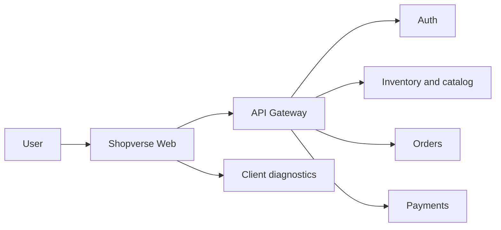

# Shopverse Web

**Project links:** [Portfolio](https://taukhir.github.io/portfolio/) · [Live Documentation](https://taukhir.github.io/shopverse/) · [Static Demo](https://taukhir.github.io/portfolio/shopverse-demo.html) · [GitHub Profile](https://github.com/taukhir) · [Resume](https://taukhir.github.io/portfolio/assets/Tauqeer-Ahmed-Resume.pdf)

## Browser Application Integration



Angular storefront and administration UI for the Shopverse local POC.

The app runs on port `4200` in local development and in the full-stack Docker
overlay. It talks to the backend through the API Gateway at `localhost:8080`.

## Responsibilities

- Customer login and registration.
- Product catalog, category, product-detail, and related-product browsing.
- Persisted cart, account-cart merge, and checkout flow with saved delivery address.
- Customer order and order-detail views.
- Recent order-activity view linked to each order's full timeline.
- Customer order cancellation, payment retry, refund request, and return request actions.
- Account/profile management and address book.
- Admin views for users, roles and permissions, orders, inventory, payments, recovery, activity, and fulfillment workflows.
- Shared back-office navigation and page-header/action framing across operations, reconciliation, returns/refunds, access management, and settings, with consistent desktop content alignment.

## Current Backend Integrations

The UI is wired to the API Gateway through `/api` and `/auth`.

| Area | Frontend behavior | Backend APIs |
|---|---|---|
| Auth/session | Login, in-memory UI identity restored from HttpOnly cookie, server-side logout | `GET /auth/csrf`, `POST /auth/login`, `GET /auth/session`, `POST /auth/logout` |
| Catalog | Product grid, detail page, related products, categories fallback | `GET /api/v1/inventory/public/items`, `GET /api/v1/inventory/public/items/{id}`, `GET /api/v1/inventory/public/items/{id}/related`, `GET /api/v1/inventory/public/categories` |
| Cart | Local fallback, persisted account cart, merge local cart after login | `GET/PUT /api/v1/cart`, `POST /api/v1/cart/merge`, `POST /api/v1/cart/validate`, `DELETE /api/v1/cart/items/{productId}` |
| Account | Profile edit and address CRUD | `GET/PUT/PATCH /api/v1/users/me`, `GET/POST/PUT/DELETE /api/v1/users/me/addresses` |
| Checkout | Two-step flow: create a priced/versioned/expiring quote for review, then place the order with the shipping snapshot and an idempotency key. Re-pricing (`GET`/`PUT`) recovers from a stale-version or expired-quote conflict without losing the review | `POST /api/v1/checkouts`, `GET/PUT /api/v1/checkouts/{checkoutId}`, `POST /api/v1/checkouts/{checkoutId}/place-order` |
| Orders | History, detail, timeline, delivery snapshot, cancel, return request | `GET /api/v1/orders`, `GET /api/v1/orders/{id}`, `GET /api/v1/orders/{id}/timeline`, `POST /api/v1/orders/{id}/cancel`, `POST /api/v1/orders/{id}/return-request` |
| Customer order activity | Recent order states and dates from the existing customer order-history response; no synthetic notification events or per-order detail fan-out | `GET /api/v1/orders` |
| Payments | Customer retry/refund actions and admin payment operations | `GET /api/v1/payments/orders/{orderNumber}`, `POST /api/v1/payments/orders/{orderNumber}/retry`, `POST /api/v1/payments/orders/{orderNumber}/refund` |
| Admin fulfillment | Pack, ship/out-for-delivery, deliver, cancel | `POST /api/v1/orders/admin/{id}/pack`, `POST /api/v1/orders/admin/{id}/ship`, `POST /api/v1/orders/admin/{id}/deliver`, `POST /api/v1/orders/admin/{id}/cancel` |
| Admin orders | Database-paged order summaries with search, status filter, and allow-listed sorting (page size 1-100) | `GET /api/v1/orders/admin?page=&size=&search=&status=&sortBy=&direction=` |
| Admin activity | Server-paged/filterable durable activity with a clearly labeled derived-data fallback | `GET /api/v1/admin/audit-events?page=&size=&area=&actor=&result=&search=`, then derived from existing admin APIs if unavailable |
| Access control | Admin role and permission catalog CRUD; pageable/searchable customer directory; assign roles from a user's profile | `GET /api/v1/admin/users?page=&size=&search=`, `GET/POST/PATCH/DELETE /api/v1/roles`, `GET/POST/PATCH/DELETE /api/v1/permissions`, `GET/PATCH /api/v1/users/{id}` |

## Local Development

Install dependencies once:

```powershell
npm ci
```

Start the Angular development server:

```powershell
npm start -- --proxy-config proxy.conf.json
```

Open:

```text
http://localhost:4200
```

`proxy.conf.json` forwards `/api` and `/auth` to the API Gateway on
`http://localhost:8080`, so start the backend stack before exercising real
catalog, auth, checkout, or admin flows.

The browser uses the same-origin `/auth` and `/api` paths through this proxy;
the access JWT is an `HttpOnly` `SHOPVERSE_ACCESS` cookie and Angular does not
read or attach it as a Bearer header. Angular reads only the `XSRF-TOKEN` cookie
to add `X-XSRF-TOKEN` on unsafe requests. Production nginx also proxies both
paths through the storefront origin. If deploying the API on a separate browser
origin, configure explicit credentialed CORS origins as well as the Gateway's
CSRF origin allowlist; the allowlist alone is not CORS configuration.

For the request-by-request login, CSRF, `/auth/session`, page reload, logout,
and token-expiry behavior, see the [Auth Service browser cookie and CSRF flow](../services/auth-service/README.md#browser-cookie-and-csrf-flow).

Recommended local backend startup from the repository root:

```powershell
docker compose --profile apps --profile assets up -d mysql mysql-bootstrap kafka minio minio-init config-server discovery-server user-service auth-service order-service payment-service inventory-service api-gateway
```

## Docker

The full-stack Compose overlay builds this app and serves it with nginx:

```powershell
docker compose --profile apps --profile assets -f docker-compose.yml -f docker-compose.full-stack.yml up --build shopverse-web
```

The nginx config proxies `/api` and `/auth` to `api-gateway:8080` and falls
back to `index.html` for Angular client-side routes.

## Scripts

| Command | Purpose |
|---|---|
| `npm start` | run Angular dev server |
| `npm run build` | production build |
| `npm run build:dev` | development build |
| `npm test` | Angular unit/component tests through the Angular Vitest runner |
| `npm run e2e:quick` | mocked Playwright coverage for critical customer/admin flows |
| `npm run e2e:full-stack` | real-stack Playwright smoke, enabled by `SHOPVERSE_FULL_STACK=1` |
| `npm run a11y` | Playwright plus axe accessibility checks |
| `npm run lighthouse` | production Lighthouse budget against the Angular app |
| `npm run visual:update` | update visual regression snapshots intentionally |
| `npm run check:web:quick` | production build, unit tests, critical E2E, accessibility, and Lighthouse |
| `npm run check:web:full` | development build, production build, unit tests, full Playwright suite, and Lighthouse |

The default E2E suite is API-mocked so it does not depend on a running backend
stack and replaces repetitive manual browser checks for the main customer and
admin journeys.

Automated coverage now replaces these routine manual checks:

- customer login redirect, cart restore after refresh, checkout, and receipt references;
- order history, order detail timeline, and payment status visibility;
- customer notification navigation renders recent order activity from the order-history API, with loading/error/empty handling;
- admin overview and admin activity backed by Order, Inventory, and Payment audit signals;
- accessibility smoke checks on home, catalog, cart, account, and admin pages;
- Lighthouse budget on the production build;
- visual snapshots for home, catalog, and admin activity when `npm run visual`
  or `npm run visual:update` is run intentionally.

From the repository root, run the frontend automation wrapper:

```powershell
.\infra\scripts\Test-ShopverseSites.ps1 -Target Web -Mode Full
```

Use `-Install` when dependencies need to be restored:

```powershell
.\infra\scripts\Test-ShopverseSites.ps1 -Target Web -Mode Full -Install
```

If local execution policy blocks scripts, run:

```powershell
powershell -NoProfile -ExecutionPolicy Bypass -File .\infra\scripts\Test-ShopverseSites.ps1 -Target Web -Mode Full
```

Run real Docker-backed UI verification from the repository root:

```powershell
powershell -NoProfile -ExecutionPolicy Bypass -File .\scripts\Test-ShopverseFullStack.ps1 -Mode Smoke -TimeoutMinutes 35
```

## Runtime Notes

- The access JWT is held in the HttpOnly `SHOPVERSE_ACCESS` cookie; Angular
  stores only the session identity/roles in memory. A full page reload calls
  `/auth/session` to rebuild that UI state. There is currently no refresh-token
  endpoint, so JWT expiry requires signing in again.
- Cart state is stored in `localStorage` first, then synced to `/api/v1/cart`
  when the customer is authenticated.
- Product catalog/detail data comes from Inventory public APIs, with the older
  Order catalog endpoint used as a fallback where needed.
- Product images are loaded from MinIO URLs returned by Inventory.
- Checkout requires at least one saved account address. The selected address is
  sent as an immutable order shipping snapshot.
- Customer payment retry/refund and return request actions are enabled only
  when the current backend status allows them.
- Admin fulfillment actions are state-gated:
  `CONFIRMED -> PACKING -> SHIPPED -> OUT_FOR_DELIVERY -> DELIVERED`.
- Admin activity tries paged `GET /api/v1/admin/audit-events` first. If that
  endpoint is unavailable, it derives a timeline from existing admin APIs.
- The Admin Orders table uses the bounded Orders endpoint and requests a new
  page when the user changes search, status, sort, or page. The legacy
  `/api/v1/orders/admin/all` remains for current overview/recovery consumers.
- Admin orders, users, activity, inventory, and payments share the same
  accessible pagination component, while each retains its route-specific row
  and detail semantics.
- Admin access control manages User Service roles and permission records;
  downstream services still need server-side authorization checks for each
  permission they intend to enforce.
- Protected API calls attach `Authorization: Bearer <token>`.

## Browser, Environment, And UX Budgets

- Validate the current stable Chromium, Firefox, and WebKit engines through the
  Playwright projects before release; document any intentionally unsupported browser.
- Keep API base URL, asset origin, and build/runtime environment values outside
  components. Do not put secrets in Angular environment files or browser storage.
- Accessibility acceptance includes keyboard-only completion, visible focus, semantic
  names, error association, landmark/headings order, contrast, zoom/reflow, and screen
  reader smoke coverage for critical journeys.
- Lighthouse and bundle budgets are release gates, not advisory screenshots. Record
  before/after LCP, CLS, INP/TBT proxy, accessibility score, and transferred JavaScript
  when changing a critical page.
- Every API-backed view needs loading, empty, partial, success, validation, authorization,
  unavailable, retry, and duplicate-submission behavior without leaking internal errors.

Known POC limits: the access JWT is now held in an HttpOnly cookie, but refresh
tokens and silent renewal are not implemented. Visual snapshots cover selected
routes rather than every responsive state. The deterministic AI evaluation uses
synthetic accessibility and Web Vitals evidence; browser tests remain authoritative.

## Validation

Build before handing off frontend changes:

```powershell
npm.cmd run check:web:quick
```

Expected output:

```text
production build, unit tests, mocked E2E, accessibility, and Lighthouse pass
```

For full-stack release confidence, still run a backend smoke once before
shipping externally:

1. Sign in as a customer.
2. Add or edit an account address.
3. Add a product to cart and refresh to confirm cart restore.
4. Checkout with the saved address.
5. Open order detail and verify timeline/payment/delivery sections.
6. Use admin order detail to pack, ship, and deliver.
7. Use customer order detail to request return when delivered.

## AI-Assisted Development

This application has scoped [`AGENTS.md`](AGENTS.md) guidance imported by
[`CLAUDE.md`](CLAUDE.md). Use:

- [UX and accessibility review](../dev-tools/ai-workflows/prompts/ux-accessibility-review.md)
- [Performance optimization](../dev-tools/ai-workflows/prompts/optimize-performance.md)
- [Implement a bounded feature](../dev-tools/ai-workflows/prompts/implement-feature.md)
- [Security review](../dev-tools/ai-workflows/prompts/security-review.md)

AI can accelerate state-matrix creation, Angular implementation, test generation,
browser inspection, accessibility review, responsive QA, and performance
analysis. It must preserve idempotent checkout behavior, backend authorization,
user-safe errors, signals/OnPush conventions, privacy, and existing shared UI
patterns. Inspect screenshots and behavior before updating visual baselines.

The deterministic evaluation suite now covers accessibility, responsive state,
duplicate submission, and measured LCP/CLS reasoning. Browser automation remains
the acceptance evidence for actual UI changes.

## Related Docs

- [Live documentation site](https://taukhir.github.io/shopverse/)
- [Root quick start](../README.md)
- [API guide](../docs/development/API-GUIDE.md)
- [Service catalog](https://taukhir.github.io/shopverse-docs/services/SERVICE-CATALOG)
- [Complete demo](../docs/case-study/COMPLETE-DEMO.md)
